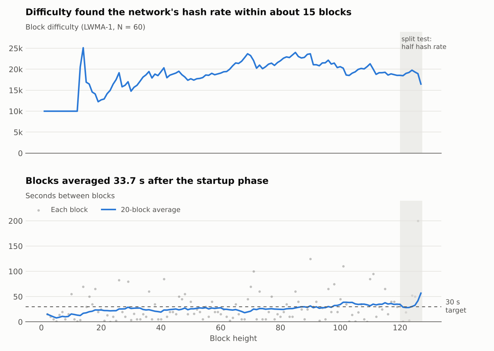

# Test report: private 3-node network

Run 2026-10-31 18:40:21 to 2026-10-31 19:48:11 with `contrib/testnet/functional_test.py` on a 2-vCPU cloud VM (3 nodes on one machine, mainnet consensus rules, isolated from the internet).

**30 of 30 checks passed.**

## Key numbers

| Measure | Result |
| --- | --- |
| Blocks mined | 128 (heights 0 to 127) |
| Mean block time after the 30-block startup | 33.66 s (target 30 s) |
| Median block time after startup | 20.0 s |
| Test transaction | 2 inputs, 3 outputs, 2393 bytes, fee 0.00370890 OPCA |
| Ring size of every input | [16] |
| Send to spendable (10 confirmations) | 350 s |
| Chain split | node 2 isolated at height 120; all nodes re-converged at heights [128, 128, 128] |
| Consensus replay | every block's difficulty and reward recomputed in Python; mismatches: 0 |

## Checks

| Check | Result | Detail |
| --- | --- | --- |
| genesis identical on all nodes | pass | 5280c46f32c71a63b78ad766654231adb5394bd5bbaeda4d5a38c9cec2ad5414 |
| genesis reward = MONEY_SUPPLY >> 22 | pass | 2384185791015 |
| standard addresses start with 'Pa' | pass | Pa2TQa1YA56Q... |
| subaddresses start with 'Ps' | pass | Ps18unbZ4rFh... |
| integrated addresses start with 'Pi' | pass | Pi2Dnq1zgxLb... |
| all nodes on the same chain tip | pass |  |
| mined coins unlocked (60-block coinbase lock) | pass |  |
| transaction confirmed in a block | pass | height 110 |
| RingCT with Bulletproofs+ (rct type 6) | pass |  |
| every input uses a 16-member ring | pass | [16, 16] |
| outputs carry view tags | pass |  |
| amounts hidden on chain (all vout amounts 0) | pass |  |
| no plaintext addresses in tx | pass |  |
| no ring member is a development fund output | pass | 0 of 32 |
| the node marks exactly the development fund outputs | pass | marked [1, 3, 5, 7, 9, 11, 13, 15, 17, 19] |
| recipient 2 received exact amount | pass | 0.05 OPCA |
| recipient 3 (subaddress) received exact amount | pass | 0.02 OPCA |
| received funds spendable after 10 blocks | pass |  |
| tx key proves payment to recipient (check_tx_key) | pass | 0.05 OPCA, 10 conf |
| payment proof verifies for a third party (get/check_tx_proof) | pass |  |
| payment proof bound to its message | pass |  |
| reserve proof shows balance without revealing history | pass | total 0.05 OPCA |
| view-only (auditor) wallet sees incoming payments | pass | 0.05 OPCA |
| recipient can re-spend received coins | pass | 4bbba542127d1c3f0ad535ca28d2b3aa21c4e21dc77866e55d64339cd24acccf |
| two competing chains exist | pass | aa1d8a0b2f98 vs 6f74aca28c55 |
| network re-converged on one chain after the split (reorg) | pass | heights [128, 128, 128] |
| replayed 128 blocks: every difficulty matches LWMA-1 reference | pass |  |
| replayed 128 blocks: every reward matches emission+fees | pass |  |
| replayed 128 blocks: every coinbase pays the development fund 5% of the subsidy | pass | fund total 15.139349 OPCA |
| anyone can audit the development fund with its public view key | pass | view-only wallet sees 15.139349 OPCA, chain owes 15.139349 |

## What this does not cover

- Behaviour under real-world latency, many peers, or adversarial miners (use the public testnet).
- Blocks above the median weight (Monero's size penalty is covered by `tests/opacra`).
- Hardware wallets and the GUI (not part of this fork).
- Side-chain, future-timestamp and slow-clock rules: `contrib/testnet/block_rules_test.py`;
  the side-chain difficulty floor: `tests/opacra`.

Genesis hash: `5280c46f32c71a63b78ad766654231adb5394bd5bbaeda4d5a38c9cec2ad5414`
