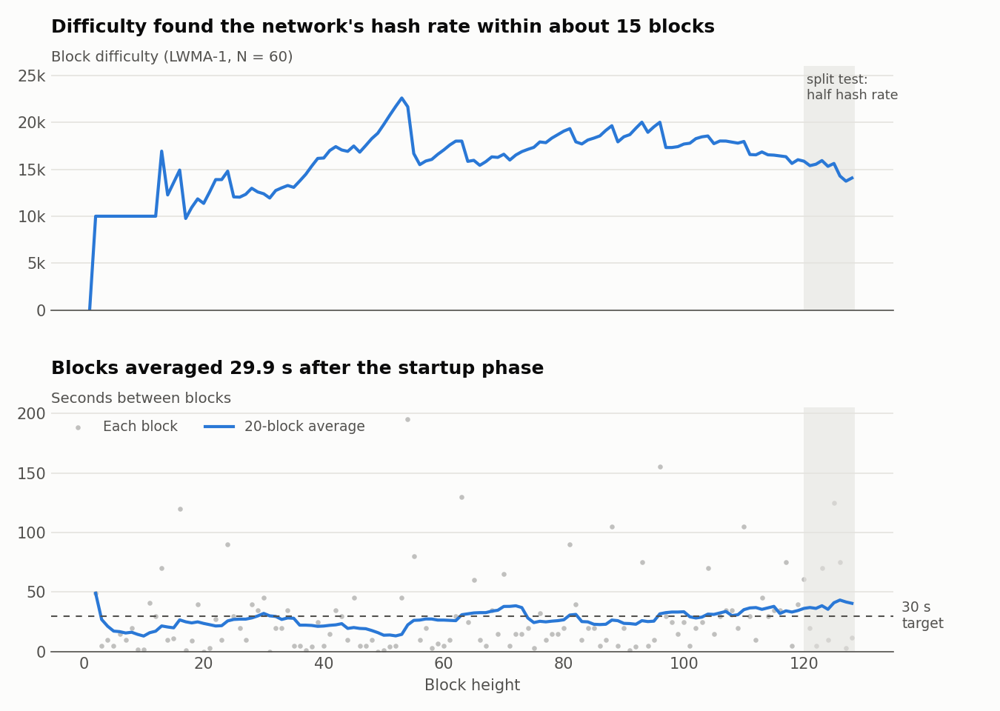

# Test report: private 3-node network

Run 2026-09-28 14:28:03 to 2026-09-28 15:33:43 with `contrib/testnet/functional_test.py` on a 2-vCPU cloud VM (3 nodes on one machine, mainnet consensus rules, isolated from the internet).

**26 of 26 checks passed.**



## Key numbers

| Measure | Result |
| --- | --- |
| Blocks mined | 128 (heights 0 to 127) |
| Mean block time after the 30-block startup | 31.36 s (target 30 s) |
| Median block time after startup | 20.0 s |
| Test transaction | 25 inputs, 3 outputs, 17550 bytes, fee 0.00144080 OPCA |
| Ring size of every input | [16] |
| Send to spendable (10 confirmations) | 366 s |
| Chain split | node 2 isolated at height 120; all nodes re-converged at heights [128, 128, 128] |
| Consensus replay | every block's difficulty and reward recomputed in Python; mismatches: 0 |

## Checks

| Check | Result | Detail |
| --- | --- | --- |
| genesis identical on all nodes | pass | b84ffdd40b388fda7e5d9eddb84355c1791f65e1b315d9e5c9d07f9880aee2f3 |
| genesis reward = MONEY_SUPPLY >> 22 | pass | 2384185791015 |
| standard addresses start with 'Ta' | pass | Ta2FKW2Rb1Qe... |
| subaddresses start with 'Ts' | pass | Ts383UESc4cf... |
| integrated addresses start with 'Ti' | pass | Ti21P6RLS79H... |
| all nodes on the same chain tip | pass |  |
| mined coins unlocked (60-block coinbase lock) | pass |  |
| transaction confirmed in a block | pass | height 110 |
| RingCT with Bulletproofs+ (rct type 6) | pass |  |
| every input uses a 16-member ring | pass | [16, 16, 16, 16, 16, 16, 16, 16, 16, 16, 16, 16, 16, 16, 16, 16, 16, 16, 16, 16, 16, 16, 16, 16, 16] |
| outputs carry view tags | pass |  |
| amounts hidden on chain (all vout amounts 0) | pass |  |
| no plaintext addresses in tx | pass |  |
| recipient 2 received exact amount | pass | 0.05 OPCA |
| recipient 3 (subaddress) received exact amount | pass | 0.02 OPCA |
| received funds spendable after 10 blocks | pass |  |
| tx key proves payment to recipient (check_tx_key) | pass | 0.05 OPCA, 10 conf |
| payment proof verifies for a third party (get/check_tx_proof) | pass |  |
| payment proof bound to its message | pass |  |
| reserve proof shows balance without revealing history | pass | total 0.05 OPCA |
| view-only (auditor) wallet sees incoming payments | pass | 0.05 OPCA |
| recipient can re-spend received coins | pass | 854b57ed578d9874c9476661854fc9e18cd2a34b2ea17ef3f7c2f9b7ab96c274 |
| two competing chains exist | pass | dc76d849516e vs a7661f2e3e2e |
| network re-converged on one chain after the split (reorg) | pass | heights [128, 128, 128] |
| replayed 128 blocks: every difficulty matches LWMA-1 reference | pass |  |
| replayed 128 blocks: every reward matches emission+slow-start+fees | pass |  |

## External miner: XMRig

After the functional test, XMRig 6.26.0 (built from source, unmodified) mined against node 0
in daemon (solo) mode with no built-in miner running:

```
./xmrig -o 127.0.0.1:31001 --daemon -u Ta2FKW2Rb1Qe... --coin monero -t 2
 * POOL #1      127.0.0.1:31001 coin Monero
 net      new job from 127.0.0.1:31001 diff 11790 algo rx/0 height 143 (1 tx)
 randomx  dataset ready (11841 ms)
 cpu      accepted (1/0) diff 11790 (19 ms)
 cpu      accepted (2/0) diff 11731 (13 ms)
 cpu      accepted (3/0) diff 12042 (14 ms)
 miner    speed 10s/60s/15m 683.0 n/a n/a H/s max 698.3 H/s
```

Over two runs XMRig added 18 blocks (heights 128 to 145); all three nodes accepted them and share the same tip.
`--coin monero` only selects the block format and algorithm; Opacra uses both unchanged.

## What this does not cover

- Behaviour under real-world latency, many peers, or adversarial miners (use the public testnet).
- Blocks above the median weight (the slow-start size cap is covered by `tests/opacra`).
- Hardware wallets and the GUI (not part of this fork).

Genesis hash: `b84ffdd40b388fda7e5d9eddb84355c1791f65e1b315d9e5c9d07f9880aee2f3`
